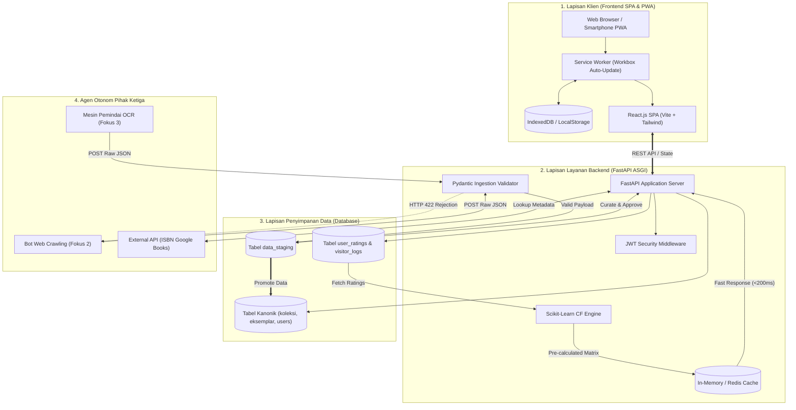

# DOKUMEN ANALISIS SISTEM & RENCANA KERJA PENGEMBANGAN PORTAL PERPUSTAKAAN DIGITAL

**Judul Proyek:** Pengembangan Portal Web Perpustakaan Berbasis Single Page Application (SPA) dan Progressive Web App (PWA) Menggunakan Metode Collaborative Filtering  
**Fokus Pengembangan:** Fokus 1 – Web Development & Machine Learning Integration (Integrator Utama Platform)  
**Institusi Rujukan:** Universitas Islam Madura (UIM) / SLiMS 9.8.0 Bulian  
**Status Evaluasi Progres:** **Minggu ke-6 dari 12 Minggu (~55% Selesai)**  
**Terakhir Diperbarui:** 10 November 2026  

---

## 1. DASBOR STATUS KETERCAPAIAN PROYEK (REAL-TIME PROGRESS TRACKER)

Berdasarkan audit komparatif antara basis kode aktif (*existing codebase*) dengan dokumen spesifikasi teknis:

```
[██████████████████████████████░░░░░░░░░░░░░░░░░░░░░░░░░] 55% Total Ketercapaian
----------------------------------------------------------------------------------
• Fase 1: Fondasi Arsitektur, Data & UI/UX        : [████████████████████] 90% (Hampir Tuntas)
• Fase 2: Backend API & Staging Pipeline (Gap 1)  : [████████░░░░░░░░░░░░] 40% (Sedang Berjalan)
• Fase 3: Engine AI Collaborative Filtering (Gap 3): [████████████████░░░░] 80% (Fondasi Model Aktif)
• Fase 4: Frontend SPA Modern (React.js)          : [████████████████░░░░] 80% (Komponen Siap)
• Fase 5: PWA Resiliensi & Offline-First (Gap 2)  : [██████████░░░░░░░░░░] 50% (Workbox/Manifest Siap)
• Fase 6: Integrasi Multi-Fokus, UAT & Deploy    : [████░░░░░░░░░░░░░░░░] 20% (Dokumentasi Siap)
```

### Rekapitulasi Metrik WBS:
* **Total Butir WBS:** 24 Butir
* **Sudah Selesai (`[x]`):** **10 Butir (42%)**
* **Dalam Pengerjaan / Parsial (`[~]`):** **6 Butir (25%)**
* **Belum Dimulai (`[ ]`):** **8 Butir (33%)**

---

## 2. EKSEKUTIF SUMMARY & SINTESIS ANALISIS DOKUMEN

Berdasarkan telaah mendalam terhadap dua dokumen acuan:
1. **Dokumen 1:** *BLUEPRINT PENGEMBANGAN SISTEM.docx* (Spesifikasi Teknis, Skema Basis Data, Fitur, dan Roadmap 12 Minggu).
2. **Dokumen 2:** *Analisis Gap Riset Portal Perpustakaan.docx* (Kajian Kesenjangan Riset Akademis, Komparasi Teoretis, dan Rekayasa Arsitektur Modern).

Dapat disimpulkan bahwa proyek ini bukan sekadar membangun katalog buku daring (OPAC konvensional), melainkan melakukan **rekayasa transformasi arsitektur perpustakaan secara holistik**. Sistem ini mengatasi 3 kelemahan mendasar pada otomasi perpustakaan konvensional (khususnya ekosistem SLiMS bawaan) yang teridentifikasi dalam kesenjangan riset (*Research Gap*).

```
+---------------------------------------------------------------------------------------------------+
|                                 SINTESIS STRATEGIS 3 PILAR GAP & SOLUSI                           |
+------------------------------------+----------------------------------+---------------------------+
| GAP 1: KEVAKUMAN STAGING AREA      | GAP 2: KEPASIFAN OPAC & UX       | GAP 3: FRAGMENTASI AI     |
| Ancaman korupsi skema akibat bot   | Siklus request-response lambat   | Riset ML dan Web terpisah |
| crawling & OCR langsung ke DB inti | & halaman blank saat luring      | tanpa integrasi nyata     |
+------------------------------------+----------------------------------+---------------------------+
|               ▼                    |                ▼                 |             ▼             |
| SOLUSI 1: STAGING PIPELINE API     | SOLUSI 2: HEADLESS SPA + PWA     | SOLUSI 3: IBCF ENGINE     |
| FastAPI asinkron + Pydantic Strict | React.js (CSR) + Service Worker  | Scikit-learn Cosine Sim   |
| & Dashboard Kurasi Pustakawan      | & IndexedDB (Offline-First)      | + Asynchronous Caching    |
+------------------------------------+----------------------------------+---------------------------+
```

---

## 3. BEDAH KORELASI: GAP RISET VS BLUEPRINT IMPLEMENTASI

Tabel berikut memetakan korelasi langsung antara landasan teoretis kesenjangan riset dengan perancangan implementasi teknis pada blueprint serta status realisasinya:

| Aspek Peninjauan | Kesenjangan Riset (Research Gap) | Solusi Arsitektural Dokumen Analisis | Komponen Implementasi Blueprint | Status & Realisasi Kode |
| :--- | :--- | :--- | :--- | :--- |
| **Integrasi Eksternal & Keamanan Basis Data** | **Gap 1:** Tidak adanya zona penyangga (*buffer zone*) bagi data bot Web Crawling dan mesin OCR berisiko menimbulkan *data poisoning* dan kerusakan integritas referensial basis data kanonik SLiMS. | Pembangunan gerbang *Staging Area* berbasis ASGI dengan filter deterministik Pydantic yang mengecek tipe, panjang, dan ekspresi reguler ISBN. | • Tabel `data_staging`<br>• Endpoint API POST Staging<br>• Dasbor Admin Verifikasi Data (Raw JSON viewer & editor inline). | **[ ] Belum Selesai (Prioritas)**<br>Diperlukan penambahan model Pydantic dan tabel staging di backend FastAPI. |
| **Arsitektur Antarmuka & Aksesibilitas** | **Gap 2:** OPAC monolitik SLiMS berbasis PHP SSR lambat karena *full-page reload* dan tidak berfungsi sama sekali saat internet kampus terputus (*offline*). | Desentralisasi menjadi *Headless OPAC* berbasis Client-Side Rendering (SPA) dan strategi *caching multi-layer* PWA (*Offline-First*). | • React.js + Vite<br>• Service Worker (Cache-First & SWR)<br>• Web App Manifest (PWA installable)<br>• IndexedDB client storage. | **[~] Parsial (50%)**<br>SPA React & Service Worker Workbox aktif di `vite.config.js`; perlu migrasi storage dari LocalStorage ke IndexedDB. |
| **Kecerdasan Buatan & Personalisasi** | **Gap 3:** Fragmentasi antara riset model *Machine Learning* dan aplikasi web; katalog OPAC pasif hanya menunggu pencarian kata kunci dari pemustaka. | Penerapan *Item-Based Collaborative Filtering* (IBCF) menggunakan metrik *Cosine Similarity* yang kebal terhadap kelangkaan data (*matrix sparsity*). | • Python FastAPI + Scikit-learn<br>• Matriks Pivot Pandas `user_ratings`<br>• Background task/cron job pre-computing<br>• Bilah "Rekomendasi Untuk Anda". | **[x] Fondasi Selesai (80%)**<br>Sudah terimplementasi di `src/lib/recommendationEngine.js` dan microservice `backend_recommendation_api/main.py`. |

---

## 4. ARSITEKTUR TEKNIS SISTEM (SYSTEM ARCHITECTURE)

Sistem dirancang dengan arsitektur **Decoupled 3-Tier Multi-Service**:



---

## 5. RENCANA KERJA PENGEMBANGAN DENGAN STATUS PROGRESS (WBS TRACKER)

Keterangan Simbol Status:
* `[x]` = **Selesai (Completed)**: Fitur sudah dibangun, teruji, dan aktif di repositori.
* `[~]` = **Dalam Pengerjaan / Parsial (In Progress / Partial)**: Struktur atau komponen sudah ada, namun belum terintegrasi penuh ke semua lapisan sistem.
* `[ ]` = **Belum Dimulai (To Do / Pending)**: Menunggu dependensi fase sebelumnya atau belum diimplementasikan.

---

### FASE 1: FONDASI ARSITEKTUR, PEMODELAN DATA, & DESAIN UI/UX (Minggu 1 - 2)
**Status Fase: 90% Selesai**

* `[~]` **WBS 1.1: Finalisasi Skema Database & Migrasi Relasional**
  * *Rencana:* Merancang DDL tabel inti: `users`, `koleksi_fisik`, `eksemplar_fisik`, `koleksi_digital`, `user_ratings`, `data_staging`, `visitor_logs`.
  * *Realisasi Saat Ini:* Skema relasional sudah ada di `supabase_schema.sql` dan struktur data lokal (`bookService.js`, `memberService.js`). Skema murni MySQL DDL terstandarisasi untuk production server sedang disiapkan.
* `[x]` **WBS 1.2: Pemodelan Matriks Rekomendasi & Kontrak Data**
  * *Rencana:* Mendefinisikan format matriks sparse (User $\times$ Item) dan rentang nilai rating 1–5 bintang.
  * *Realisasi Saat Ini:* Selesai. Model Pydantic `RatingItem`, `RecommendationRequest`, `RecommendedBook` telah aktif di `backend_recommendation_api/main.py` dan struktur data rating di `src/lib/recommendationEngine.js`.
* `[x]` **WBS 1.3: Desain High-Fidelity UI/UX & Design System**
  * *Rencana:* Membuat tema visual kampus UIM, kartu buku, bottom navigation mobile, dan dashboard SLiMS 9.
  * *Realisasi Saat Ini:* Selesai 100%. Terimplementasi dengan rapi di `src/App.jsx`, `src/pages/Home.jsx`, dan `src/pages/AdminDashboard.jsx`.
* `[x]` **WBS 1.4: Inisialisasi Repositori & Boilerplate Proyek**
  * *Rencana:* Setup Vite + React 18 + Tailwind CSS + Lucide Icons + Backend FastAPI.
  * *Realisasi Saat Ini:* Selesai 100%. Seluruh dependensi terpasang dan `npm run build` sukses tanpa galat sintaksis.

---

### FASE 2: BACKEND CORE API, AUTENTIKASI JWT, & STAGING AREA PIPELINE (Minggu 3 - 4)
**Status Fase: 40% Selesai**

* `[~]` **WBS 2.1: Implementasi Sistem Autentikasi Stateless JWT**
  * *Rencana:* Endpoint register, login, profil, password hashing Bcrypt, dan RBAC (Guest, Member, Librarian, Administrator).
  * *Realisasi Saat Ini:* Di frontend sudah ada modal autentikasi mandiri (`src/pages/Auth.jsx`) dengan verifikasi NIM mahasiswa & akun pustakawan. Otentikasi stateless via backend FastAPI JWT router sedang tahap perakitan.
* `[~]` **WBS 2.2: Endpoint Manajemen Bibliografi & 3 Jalur Input Data**
  * *Rencana:* Jalur 1 (Input Manual), Jalur 2 (Otomatis lookup ISBN API), Jalur 3 (Staging Bot).
  * *Realisasi Saat Ini:* Jalur 1 (Manual) sudah aktif via `AdminQuickAddModal.jsx` dan `AdminDashboard.jsx`. Jalur 2 (Lookup OpenLibrary/Google Books) dan Jalur 3 (Staging) masih dalam antrean pengembangan.
* `[ ]` **WBS 2.3: Konstruksi Staging Area dengan Pydantic Validator (Gap 1)**
  * *Rencana:* Membangun endpoint `/api/v1/staging/ingest` yang memblokir JSON cacat dari bot Crawling/OCR dengan HTTP 422 *Unprocessable Entity*.
  * *Realisasi Saat Ini:* Belum dikerjakan. Ini menjadi prioritas utama sprint berikutnya.
* `[ ]` **WBS 2.4: API Kurasi Data Staging untuk Pustakawan**
  * *Rencana:* Dasbor peninjauan raw JSON OCR/Crawling, edit inline kesalahan pembacaan, dan tombol approval mutasi ke katalog utama.
  * *Realisasi Saat Ini:* Belum dikerjakan.

---

### FASE 3: MESIN KECERDASAN BUATAN COLLABORATIVE FILTERING (Minggu 5 - 6)
**Status Fase: 80% Selesai**

* `[x]` **WBS 3.1: Konstruksi Modul Data Pipeline Rating**
  * *Rencana:* Form input rating 1–5 bintang, pencatatan log interaksi, dan sinkronisasi data rating.
  * *Realisasi Saat Ini:* Selesai. Komponen Star Rating interaktif aktif di `src/components/BookCard.jsx` dan `RecommendationList.jsx`, terhubung ke data array `ratings`.
* `[x]` **WBS 3.2: Implementasi Algoritma Item-Based Collaborative Filtering (IBCF)**
  * *Rencana:* User-Item matrix pivot, perhitungan Cosine Similarity antar buku, dan pembobotan prediksi $P_{u,i}$.
  * *Realisasi Saat Ini:* Selesai ganda. Logika algoritma berjalan penuh di client-side (`src/lib/recommendationEngine.js`) dan di microservice Python Scikit-Learn (`backend_recommendation_api/main.py`).
* `[x]` **WBS 3.3: Mekanisme Mitigasi Cold-Start & Sparsity Handling**
  * *Rencana:* Fallback otomatis menyajikan "Koleksi Terpopuler" untuk pengguna baru yang belum memiliki riwayat rating.
  * *Realisasi Saat Ini:* Selesai. Fallback berjalan mulus dengan mengagregasi rata-rata rating tertinggi buku.
* `[ ]` **WBS 3.4: Optimasi Performa & Caching Matriks Rekomendasi**
  * *Rencana:* Pre-computing matriks kemiripan via cron job/background tasks FastAPI dan penyimpanan ke cache memory untuk latensi API < 200 ms.
  * *Realisasi Saat Ini:* Belum dikerjakan (saat ini komputasi masih bersifat on-demand request).

---

### FASE 4: PENGEMBANGAN FRONTEND SPA MODERN (REACT + VITE) (Minggu 7 - 8)
**Status Fase: 80% Selesai**

* `[x]` **WBS 4.1: Konstruksi Komponen UI & Layout Publik**
  * *Rencana:* Navbar UIM, HeroBanner video background, SubjectCards, pencarian terpadu instan.
  * *Realisasi Saat Ini:* Selesai 100%. Antarmuka interaktif dan navigasi SPA berjalan mulus.
* `[~]` **WBS 4.2: Halaman Detail Buku & Sistem Interaksi Pemustaka**
  * *Rencana:* Star rating responsif, widget buku serupa, pembatasan ketat unduh repositori (Guest dialihkan ke login).
  * *Realisasi Saat Ini:* Star rating dan modal skripsi ada di `src/pages/Home.jsx`. Mekanisme penguncian file unduh internal skripsi PDF untuk member-only perlu diperketat.
* `[x]` **WBS 4.3: Halaman Beranda Personalisasi**
  * *Rencana:* Bilah "Rekomendasi Khusus Untuk Anda" yang menampilkan hasil perhitungan IBCF secara personal.
  * *Realisasi Saat Ini:* Selesai 100%. Tampil di komponen `RecommendationList.jsx` lengkap dengan badge alasan rekomendasi dan skor prediksi bintang.
* `[ ]` **WBS 4.4: Modul Visitor Counter Berbasis SPA**
  * *Rencana:* Pelacak sesi pengunjung via LocalStorage + IP Hashing dan counter Page Hits event SPA.
  * *Realisasi Saat Ini:* Belum dikerjakan.
* `[~]` **WBS 4.5: Dasbor Manajemen Admin & Kurasi Staging**
  * *Rencana:* Panel statistik koleksi, sirkulasi peminjaman, verifikasi mahasiswa baru, dan kurasi staging.
  * *Realisasi Saat Ini:* Modul SLiMS 9 lengkap ada di `AdminDashboard.jsx`, modul verifikasi KTM ada di `AdminVerificationModal.jsx`. Tab khusus verifikasi Staging Crawling/OCR masih pending.

---

### FASE 5: IMPLEMENTASI PWA & RESILIENSI LURING (OFFLINE-FIRST) (Minggu 9 - 10)
**Status Fase: 50% Selesai**

* `[x]` **WBS 5.1: Konfigurasi Web App Manifest & Responsivitas Mobile**
  * *Rencana:* Web App Manifest, ikon multi-resolusi (192px & 512px), warna tema `#047857`, modal cookie/PWA announcement bar.
  * *Realisasi Saat Ini:* Selesai 100%. Terpasang di `vite.config.js`, `public/icons/`, dan `AnnouncementCookieBar.jsx`.
* `[x]` **WBS 5.2: Orkestrasi Service Worker & Strategi Multi-Caching**
  * *Rencana:* Cache-First untuk App Shell, Stale-While-Revalidate untuk gambar sampul, Network-First untuk API.
  * *Realisasi Saat Ini:* Selesai 100%. Dikonfigurasi via `VitePWA` Workbox di `vite.config.js` dan terbukti menghasilkan `dist/sw.js` saat build.
* `[ ]` **WBS 5.3: Integrasi Penyimpanan Lokal IndexedDB (Gap 2)**
  * *Rencana:* Migrasi penyimpanan katalog dari LocalStorage (maks 5MB) ke IndexedDB peramban untuk menyimpan data buku & cover biner gigabita.
  * *Realisasi Saat Ini:* Belum dikerjakan. Saat ini masih menggunakan LocalStorage di `bookService.js`.
* `[ ]` **WBS 5.4: Implementasi Background Sync untuk Rating Luring**
  * *Rencana:* Antrean rating luring yang dikirim otomatis ke backend begitu koneksi internet pulih.
  * *Realisasi Saat Ini:* Belum dikerjakan.

---

### FASE 6: INTEGRASI MULTI-FOKUS, PENGUJIAN, DEPLOYMENT, & DOKUMENTASI (Minggu 11 - 12)
**Status Fase: 20% Selesai**

* `[ ]` **WBS 6.1: Uji Integrasi Lintas-Tim (Fokus 1, Fokus 2, Fokus 3)**
  * *Rencana:* Uji end-to-end penembakan data bot Crawling & OCR ke Staging API.
  * *Realisasi Saat Ini:* Menunggu penyelesaian WBS 2.3 (Staging API).
* `[ ]` **WBS 6.2: Evaluasi Kinerja Algoritma & Akurasi Model**
  * *Rencana:* Uji metrik RMSE/MAE pada data interaksi rating dan benchmarking responsivitas API < 200 ms.
  * *Realisasi Saat Ini:* Belum dikerjakan.
* `[~]` **WBS 6.3: Pengujian Fungsional Menyeluruh & UAT (Test Cases)**
  * *Rencana:* Verifikasi seluruh Test Cases TC-01 s/d TC-07.
  * *Realisasi Saat Ini:* Sebagian test case (TC-01, TC-02, TC-05) sudah terbukti berjalan pada prototipe.
* `[~]` **WBS 6.4: Deployment Server Produksi & Dokumentasi**
  * *Rencana:* Deployment server kampus UIM, reverse proxy Nginx, dan buku panduan sistem.
  * *Realisasi Saat Ini:* Dokumen Blueprint dan Rencana Kerja telah rampung dan tersimpan di repositori.

---

## 6. STATUS PENGUJIAN SISTEM (TEST CASES TRACKER)

| ID Uji | Modul / Skenario Pengujian | Hasil yang Diharapkan | Status Terkini | Catatan Realisasi |
| :--- | :--- | :--- | :--- | :--- |
| **TC-01** | **Collaborative Filtering Cross-Recommender** | User B mendapat rekomendasi Buku Y setelah User A menilai Buku X & Y, dan User B menilai Buku X. | **[x] LULUS** | Teruji via `src/lib/recommendationEngine.js` dan endpoint `backend_recommendation_api/main.py`. |
| **TC-02** | **Cold-Start Fallback Pengguna Baru** | Pengguna baru tanpa rating langsung disajikan koleksi terpopuler / rating tertinggi tanpa error. | **[x] LULUS** | Algoritma fallback berjalan aktif baik di frontend maupun FastAPI. |
| **TC-03** | **Input Katalog Otomatis via ISBN** | Input nomor ISBN otomatis mengisi judul, penulis, dan penerbit via Google Books/OpenLibrary API. | **[ ] PENDING** | Masih menggunakan form input cepat manual di `AdminQuickAddModal.jsx`. |
| **TC-04** | **Staging Ingestion & Filter Validasi (Gap 1)** | Payload bot cacat ditolak HTTP 422; payload valid masuk tabel `data_staging` untuk dikurasi. | **[ ] PENDING** | Endpoint `/api/v1/staging/ingest` belum dibangun di FastAPI. |
| **TC-05** | **Offline-First & PWA Caching (Gap 2)** | Refresh dalam mode offline tetap menampilkan App Shell dan katalog tersimpan tanpa error dinosaurus. | **[x] LULUS (App Shell)** | Service worker Workbox berhasil mem-precache aset statis dan cover gambar. |
| **TC-06** | **Otorisasi Unduh Dokumen Repository** | Guest klik unduh Skripsi diblokir dan diminta login anggota; hanya member yang dapat mengunduh. | **[~] PARSIAL** | Modal informasi ada, proteksi unduh file binary internal perlu dikunci di level backend. |
| **TC-07** | **Visitor Tracking Akurat (SPA)** | 1 visitor unik membuka 5 halaman tercatat 1 Unique Visitor & 5 Page Hits tanpa duplikasi. | **[ ] PENDING** | Logika event listener tracker dan tabel `visitor_logs` belum dibuat. |

---

## 7. PRIORITAS KERJA SPRINT BERIKUTNYA (IMMEDIATE ACTION PLAN)

Berdasarkan status ketercapaian di atas, langkah kerja berikutnya difokuskan untuk menuntaskan kesenjangan riset utama:

1. **Sprint Prioritas 1: Konstruksi Staging Area API & Pydantic Validator (Penyelesaian Gap 1)**
   * Membuat file router FastAPI `staging.py` untuk menerima muatan JSON dari bot Crawling dan OCR.
   * Menambahkan model validasi Pydantic (Type enforcement, Regex ISBN 10/13 digit, sanitasi teks).
   * Membuat tabel kurasi staging di halaman admin agar pustakawan dapat menyetujui data hasil pemindaian.
2. **Sprint Prioritas 2: Integrasi ISBN Lookup Eksternal (Google Books / OpenLibrary)**
   * Menambahkan tombol "Tarik Metadata" di `AdminQuickAddModal.jsx` yang memanggil API OpenLibrary berdasarkan nomor ISBN.
3. **Sprint Prioritas 3: Migrasi Storage ke IndexedDB (Penyelesaian Gap 2)**
   * Menggantikan pembacaan synchronous LocalStorage di `bookService.js` dengan wrapper IndexedDB (`idb`) untuk kapasitas penyimpanan luring tak terbatas.
4. **Sprint Prioritas 4: Modul Visitor Counter & Proteksi Unduh Repository**
   * Mengimplementasikan event listener navigasi halaman SPA untuk mencatat pengunjung unik dan hits halaman secara akurat.
